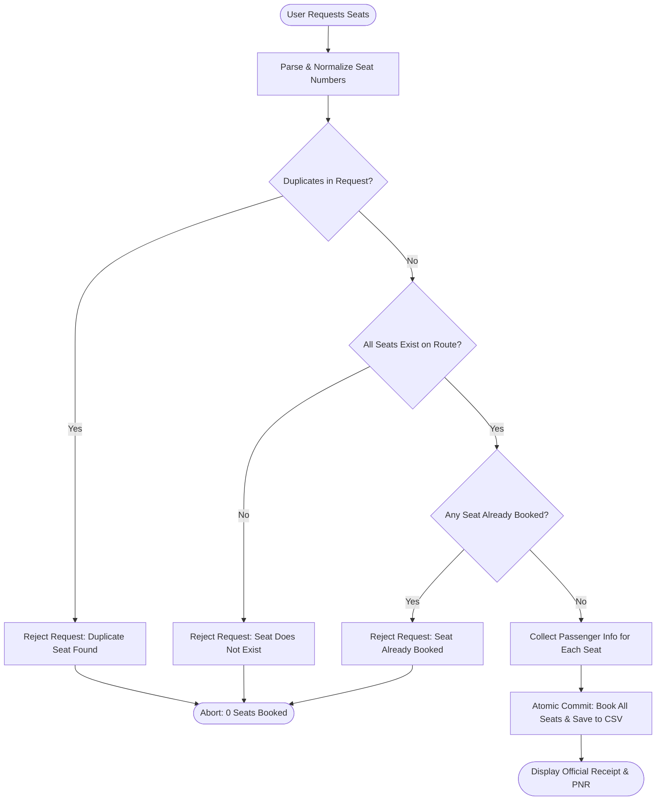

# NammaRoute Travels – Bus Booking Management System (Version 2.0)

A production-grade, menu-driven Core Java 17 console application for managing bus schedules, visual seat allocations, atomic ticket reservations, dynamic surge pricing, female passenger co-seat safety rules, FIFO waitlists with smart auto-promotion, cancellations with refund processing, passenger manifests, and local CSV persistence.

Developed using clean Object-Oriented Programming (OOP) principles, robust defensive input validation, and thread-safe file handling without external framework bloat.

---

## 🚀 Version 2.0 Change Request & Operations Upgrades

In preparation for peak Friday night Bengaluru–Goa schedules, the operations team requested three critical upgrades in Version 2.0, implemented with 100% backward compatibility and verified by **77 automated regression tests**:

| Change | Upgrade Specification | Implementation Details |
| :--- | :--- | :--- |
| **Change 1** | **Dynamic Surge Pricing (70% Occupancy Rule)** | When a bus becomes $\ge 70\%$ full, all remaining empty seats automatically cost **20% extra** above base fare. Existing passengers keep their booked rate. If cancellations drop occupancy below 70%, prices revert to normal. Upfront price transparency in seat maps. |
| **Change 2** | **Female Passenger Co-Seat Safety Rule** | In any 2-seat pair (1A-1B, 1C-1D, or double berths L1-L2), if one seat is booked by a solo female, the adjacent seat can only be booked by another female. Male attempts are blocked with exact error: `"Sorry, seat <X> is reserved for a female co-passenger. Please choose another seat."`<br>**Group Exception:** Husband/wife or family booking both seats together on the same PNR are permitted. |
| **Change 3** | **FIFO Waitlist & Smart Safety Auto-Promotion** | When a bus is 100% full (0 available seats), allows up to 5 passengers to join a First-In, First-Out (FIFO) Waitlist. Upon seat cancellation, the freed seat is automatically assigned to the first eligible person in queue with a new confirmed PNR.<br>**Smart Safety Check:** If freed seat is next to a female, males are skipped (kept at front of queue) and the next eligible female is promoted. Persisted to `data/waitlist.csv`. |

---

## 1. Executive Summary & Features

| Feature | Description |
| :--- | :--- |
| **Bus Management** | Add and view routes (2x2 Seater with 32 seats; 2x1 Sleeper with 24 berths). Preloaded with 3 demo routes. |
| **Visual Seat Layout** | Interactive ASCII seat maps with aisle separation: `[01A]` = Available, `[ XX]` = Booked. Real-time availability updates. |
| **Atomic Reservations** | Multi-seat bookings with atomic validation: if any requested seat is invalid or booked, no seats are booked. Unique PNR generation (`PNR-XXXXX`). |
| **Receipt Generation** | Formatted booking receipts with route info, passenger roster, seat numbers, fare breakdown, and timestamps. |
| **Ticket Cancellation** | Cancel entire booking or specific seats from multi-seat bookings. Immediate seat release, 100% refund calculation, and updated status. |
| **Passenger Manifest** | Filter by Route ID, display all booked passengers sorted naturally by seat number (e.g. `1A` < `1B` < `2A`), and passenger counts. |
| **PNR Lookup** | Instant lookup of any active or cancelled reservation by PNR. |
| **Data Persistence** | Local CSV storage (`buses.csv`, `bookings.csv`) with RFC-4180 quote escaping, automatic file initialization, and restart recovery. |
| **Defensive Validation** | Never crashes on bad input: loops on invalid strings, non-numeric values, out-of-range dates, or duplicate entries. |

---

## 2. Technology Stack

- **Language**: Java 17 (Core Java)
- **Data Structures**: Collections Framework (`ArrayList`, `LinkedHashMap`, `HashSet`, `Collections.unmodifiableList`)
- **Date & Time API**: `java.time.LocalDateTime`, `java.time.format.DateTimeFormatter`
- **File I/O**: `java.io.BufferedReader`, `BufferedWriter`, `FileReader`, `FileWriter`, `java.nio.file.Files`
- **Build / Execution**: Direct JDK CLI (`javac` / `java`), Windows Batch (`run.bat`), PowerShell (`run.ps1`)
- **Dependencies**: Zero external dependencies (no Spring Boot, no external DB, pure standard JDK).

---

## 3. Project Architecture & Directory Layout

```
NammaRouteTravels/
│
├── bin/                                         # Compiled bytecode class files
├── data/                                        # Local CSV persistent data store
│   ├── buses.csv                                # Bus route records
│   └── bookings.csv                             # Passenger booking records
│
├── src/
│   ├── main/java/com/nammaroute/
│   │   ├── Main.java                            # Console entry point & menu controller
│   │   │
│   │   ├── model/
│   │   │   ├── BusType.java                     # Enum for SEATER (32) and SLEEPER (24)
│   │   │   ├── Seat.java                        # Seat status, normalization, & natural comparator
│   │   │   ├── Passenger.java                   # Passenger details, seat association, & status
│   │   │   ├── Bus.java                         # Bus entity, seat layout maps, & visual rendering
│   │   │   └── Booking.java                     # Reservation aggregate (PNR, passengers, fare)
│   │   │
│   │   ├── service/
│   │   │   ├── BusService.java                  # Bus management & schedule queries
│   │   │   ├── BookingService.java              # Atomic booking, cancellation & refund calculation
│   │   │   └── ManifestService.java             # Sorted passenger manifest reporting
│   │   │
│   │   ├── storage/
│   │   │   └── FileStorageService.java          # RFC-4180 CSV serialization, deserialization, recovery
│   │   │
│   │   └── util/
│   │       └── InputValidator.java              # Input reading, sanitization, and defensive checks
│   │
│   └── test/java/com/nammaroute/
│       └── AppTest.java                         # Automated verification suite (11 required scenarios)
│
├── run.bat                                      # One-click Windows CMD compile & run script
├── run.ps1                                      # One-click PowerShell compile & run script
└── README.md                                    # Comprehensive system documentation
```

---

## 4. Class-by-Class Explanation

### 1. `Main.java`
- **Responsibility**: Application entry point, console UI menu loop, and routing user choices to appropriate service methods.
- **Key Methods**:
  - `main(String[] args)`: Initializes services and starts the application loop.
  - `run()`: Menu loop handling options 1 to 8, catching runtime stream exceptions cleanly.
  - `handleAddNewBus()`, `handleBookTickets()`, `handleCancelTickets()`, `handleGenerateManifest()`, `handleSearchBookingByPnr()`.

### 2. `model/BusType.java`
- **Responsibility**: Type-safe enumeration of supported coach formats.
- **Constants**:
  - `SEATER`: 2x2 layout, 32 seats (8 rows of 4 seats: A, B, C, D).
  - `SLEEPER`: 2x1 layout, 24 berths (12 lower berths L1–L12, 12 upper berths U1–U12).

### 3. `model/Seat.java`
- **Responsibility**: Encapsulates seat state (normalized seat number, seat type, and booked flag).
- **Key Methods**:
  - `normalize(String raw)`: Converts user input like `01A`, `1a` -> `1A`, or `l01` -> `L1`.
  - `getDisplayLabel()`: Returns fixed 3-character display strings (`01A`, `L01`, `U12`).
  - `compareSeats(String s1, String s2)`: Natural comparator ensuring numeric ordering (e.g. `1A` < `2A` < `10A`, `L1` < `L2` < `U1`).

### 4. `model/Passenger.java`
- **Responsibility**: Holds individual passenger details associated with a booked seat.
- **Fields**: `name`, `age`, `gender` ("M", "F", "Other"), `seatNumber`, `fare`, and `status` ("CONFIRMED" or "CANCELLED").

### 5. `model/Bus.java`
- **Responsibility**: Represents a scheduled bus journey and its physical seat grid.
- **Fields**: `routeId`, `origin`, `destination`, `departureTime`, `basePrice`, `busType`, `seats` (`LinkedHashMap<String, Seat>`).
- **Key Methods**:
  - `initializeSeats()`: Automatically builds the seat map based on `BusType`.
  - `bookSeat(seatNum)` / `releaseSeat(seatNum)`: Thread-safe state modification.
  - `displaySeatMap()`: Renders ASCII layout with driver cabin, aisles, and deck separators.

### 6. `model/Booking.java`
- **Responsibility**: Root aggregate representing a ticket reservation under a single PNR.
- **Key Methods**:
  - `recalculateTotalFare()`: Recalculates total payable amount strictly based on `CONFIRMED` passengers.
  - `cancelSeat(seatNum)`: Marks a specific passenger record as `CANCELLED` and triggers fare recalculation.
  - `printReceipt(bus)`: Prints formatted receipt with journey details, seat numbers, individual ticket fares, and status.

### 7. `service/BusService.java`
- **Responsibility**: In-memory registry and lifecycle manager for all bus routes.
- **Key Methods**:
  - `addBus(Bus)`: Validates that Route ID is unique before inserting into the map and saving to CSV.
  - `getBus(routeId)`: Case-insensitive route lookup.
  - `displayAllBuses()`: Tabular view of all active routes, timings, fares, and available seats.

### 8. `service/BookingService.java`
- **Responsibility**: Core transactional business logic for bookings, cancellations, and refunds.
- **Key Methods**:
  - `generateUniquePnr()`: Generates unique 5-digit PNR strings (`PNR-XXXXX`).
  - `bookTickets(routeId, passengers)`: Atomically reserves seats, updates bus state, writes to storage, and prints receipt.
  - `cancelTickets(pnr, seatsToCancel)`: Releases seats, invokes refund logic, updates booking status, and persists changes.
  - `calculateRefund(seatsCount, farePerSeat)`: Isolated method calculating 100% refund.

### 9. `service/ManifestService.java`
- **Responsibility**: Operational reporting for bus conductors and depot staff.
- **Key Methods**:
  - `generateManifest(routeId, busService, bookingService)`: Aggregates active passengers on a route, sorts them by seat number, and renders summary stats.

### 10. `storage/FileStorageService.java`
- **Responsibility**: Reliable local disk persistence via CSV files.
- **Key Methods**:
  - `loadBuses()`: Loads routes; preloads demo routes (`NR-101`, `NR-102`, `NR-103`) if storage is empty.
  - `saveBuses(Collection<Bus>)`: Overwrites `buses.csv`.
  - `loadBookings(Map<String, Bus>)`: Reconstructs bookings, reconciles confirmed seats onto buses.
  - `saveBookings(Collection<Booking>)`: Overwrites `bookings.csv`.
  - `parseCsvLine(String line)` / `escapeCsv(String val)`: Implements RFC-4180 compliant CSV parsing/escaping.

### 11. `util/InputValidator.java`
- **Responsibility**: Defensive input handling to prevent application crashes.
- **Key Methods**:
  - `readNonEmptyString()`, `readIntInRange()`, `readPositiveDouble()`, `readDateTime()`, `readGender()`.
  - `parseSeatInput()`: Parses comma/space-delimited seat lists.
  - `validateSeatsForBooking()`: Detects intra-request duplicates, non-existent seats, or already-booked seats.

---

## 5. Object-Oriented Programming (OOP) Principles Applied

1. **Encapsulation**:
   - All model fields are `private` or `private final`.
   - Access is mediated through public getters, setters, and business methods (`bookSeat()`, `releaseSeat()`).
   - `Bus.getSeats()` returns an unmodifiable view via `Collections.unmodifiableMap()`, preventing external mutation.

2. **Abstraction**:
   - Complex seat layout logic is abstracted behind `bus.displaySeatMap()`.
   - Complex CSV tokenization (handling embedded quotes and commas) is hidden inside `FileStorageService.parseCsvLine()`.
   - The user interacts with high-level menu operations without needing to know storage mechanics.

3. **Composition & Aggregation**:
   - A `Bus` **has-a** collection of `Seat` objects (`LinkedHashMap<String, Seat>`).
   - A `Booking` **has-a** collection of `Passenger` objects.
   - `BookingService` and `BusService` are composed into `Main` to orchestrate operations cleanly.

4. **Single Responsibility Principle (SRP)**:
   - `Bus` only manages bus properties and seat states.
   - `BookingService` only manages reservation workflows.
   - `FileStorageService` only manages disk serialization.
   - `InputValidator` only manages input sanitization.

---

## 6. Booking Validation & Atomic Seat Allocation

The booking workflow strictly enforces **atomic transactions**:



### Key Guarantees:
- **No Partial Bookings**: If a user requests `[1A, 1B, 1C]` and seat `1C` is already booked, neither `1A` nor `1B` is reserved.
- **Normalization**: User input like `01a`, `1A`, `l1`, `L01` are normalized to canonical keys (`1A`, `L1`), preventing casing or padding bypasses.
- **In-Memory & Persistent Sync**: Status changes are committed to the in-memory `Bus` object and immediately flushed to `data/bookings.csv`.

---

## 7. Data Persistence Specification

### `data/buses.csv`
```csv
RouteId,Origin,Destination,DepartureTime,BasePrice,BusType
NR-101,Bengaluru,Goa,2026-11-27 21:30,1200.00,SEATER
NR-102,Bengaluru,Hyderabad,2026-11-28 20:00,900.00,SLEEPER
NR-103,Bengaluru,Chennai,2026-11-29 22:00,800.00,SEATER
```

### `data/bookings.csv`
```csv
PNR,RouteId,BookingTime,SeatNumber,PassengerName,PassengerAge,PassengerGender,Fare,Status
PNR-12289,NR-102,2026-11-24 16:03,L1,Amit Patel,30,M,900.00,CONFIRMED
PNR-12289,NR-102,2026-11-24 16:03,L2,Kavita Patel,28,F,900.00,CANCELLED
```

### Persistence Features:
- **RFC-4180 Compliant**: Names with commas (e.g. `"Rao, Vikram"`) or double quotes are automatically quoted and escaped.
- **Audit History**: When partial seats are cancelled, the passenger row remains in `bookings.csv` marked as `CANCELLED`, preserving passenger audit logs and correct refund accounting.
- **Restart Recovery**: On application start, `FileStorageService.loadBookings()` parses all records, reconstructs `Booking` aggregates, and marks only `CONFIRMED` seats as booked on their corresponding `Bus` instances.

---

## 8. Compilation and Execution Guide (Windows)

### Prerequisites
- JDK 17 or higher installed (Java 17, 21, 24+).
- Ensure `javac` and `java` are available in your PATH or configured in `%JAVA_HOME%`.

### Option A: One-Click Launcher (Recommended)

Double-click or run from command prompt:
```cmd
run.bat
```
Or via PowerShell:
```powershell
.\run.ps1
```

### Option B: Manual Command-Line Compilation (Windows Command Prompt / PowerShell)

1. **Navigate to the project root**:
   ```cmd
   cd "C:\Users\Admin\OneDrive\Desktop\Namma Route Travels- Bus Booking Management System"
   ```

2. **Compile all Java source files into `bin/`**:
   ```cmd
   javac --release 17 -d bin src\main\java\com\nammaroute\model\*.java src\main\java\com\nammaroute\storage\*.java src\main\java\com\nammaroute\util\*.java src\main\java\com\nammaroute\service\*.java src\main\java\com\nammaroute\Main.java
   ```

3. **Run the Application**:
   ```cmd
   java -cp bin com.nammaroute.Main
   ```

4. **Compile and Run the Automated Test Suite**:
   ```cmd
   javac --release 17 -cp bin -d bin src\test\java\com\nammaroute\AppTest.java
   java -cp bin com.nammaroute.AppTest
   ```

---

## 9. Automated Test Suite (11 Scenarios Verified)

The project includes an automated test runner `AppTest.java` that validates all 11 required scenarios:

| # | Test Scenario | Verified Behavior | Status |
| :-: | :--- | :--- | :---: |
| **1** | Add a new bus | Successfully adds `NR-104`; rejects duplicate Route ID `NR-104` | **PASS** |
| **2** | View all buses | Verifies preloaded routes (`NR-101`, `NR-102`, `NR-103`) + new `NR-104` | **PASS** |
| **3** | Display empty seat map | Capacity 32, available 32, booked 0 | **PASS** |
| **4** | Book two seats | Books `1A` & `1B` on `NR-101`, generates `PNR-XXXXX`, updates seat counts | **PASS** |
| **5** | Book already-booked seat | Rejects request for `1A`; ensures transaction is atomic | **PASS** |
| **6** | Book invalid seat | Rejects non-existent seat `9Z` before any booking happens | **PASS** |
| **7** | Search booking by PNR | Accurately returns passenger list, journey details, and status | **PASS** |
| **8** | Partial cancellation | Cancels `1B`, retains `1A`, recalculates fare to Rs. 1200.00 | **PASS** |
| **9** | Seat release verification | Verifies `1B` is immediately available; `1A` remains booked | **PASS** |
| **10** | Passenger manifest | Displays sorted roster for `NR-101`, matching total booked/available | **PASS** |
| **11** | Application restart | Re-instantiates storage and services; confirms data persisted | **PASS** |

**Test Result Summary: 40 Assertions Checked, 40 Passed, 0 Failed.**

---

## 10. Sample Console Output

### A. Main Menu
```
========================================
       NAMMAROUTE TRAVELS               
       BUS BOOKING SYSTEM               
========================================

1. Add New Bus
2. View All Buses
3. View Seat Availability
4. Book Tickets
5. Cancel Tickets
6. Generate Passenger Manifest
7. Search Booking by PNR
8. Exit

Enter your choice: 
```

### B. Visual Seat Map (2x2 Seater: NR-101)
```
==========================================================================
           VISUAL SEAT MAP - ROUTE: NR-101 (Bengaluru -> Goa)
==========================================================================
Bus Type    : 2x2 Seater (32 Seats)
Departure   : 2026-11-27 21:30
Ticket Fare : Rs. 1200.00 per seat
Capacity    : Total: 32  |  Booked: 2  |  Available: 30
--------------------------------------------------------------------------
                     [ FRONT / DRIVER CABIN ]
          LEFT (WINDOW / AISLE)          RIGHT (AISLE / WINDOW)
--------------------------------------------------------------------------
Row 01:     [ XX] [ XX]        | AISLE |        [01C] [01D]
Row 02:     [02A] [02B]        | AISLE |        [02C] [02D]
Row 03:     [03A] [03B]        | AISLE |        [03C] [03D]
Row 04:     [04A] [04B]        | AISLE |        [04C] [04D]
Row 05:     [05A] [05B]        | AISLE |        [05C] [05D]
Row 06:     [06A] [06B]        | AISLE |        [06C] [06D]
Row 07:     [07A] [07B]        | AISLE |        [07C] [07D]
Row 08:     [08A] [08B]        | AISLE |        [08C] [08D]
--------------------------------------------------------------------------
Legend: [01A] / [L01] = Available     [ XX] = Booked
==========================================================================
```

### C. Booking Receipt
```
==========================================================================
                           NAMMAROUTE TRAVELS                             
                        OFFICIAL BOOKING RECEIPT                          
==========================================================================
PNR Number       : PNR-85021
Booking Date/Time: 2026-11-24 16:03
Booking Status   : CONFIRMED
--------------------------------------------------------------------------
Bus Route ID     : NR-101
Journey          : Bengaluru -> Goa
Departure Time   : 2026-11-27 21:30
Bus Type         : 2x2 Seater
Base Ticket Fare : Rs. 1200.00
--------------------------------------------------------------------------
PASSENGER DETAILS:
No.  Seat     Passenger Name             Age    Gender   Fare (INR)   Status
--------------------------------------------------------------------------
1    01A      Rahul Sharma               28     M        Rs. 1200.00   CONFIRMED
2    01B      Priya Sharma               26     F        Rs. 1200.00   CONFIRMED
--------------------------------------------------------------------------
Active Seats Booked : 2
Total Amount Paid   : Rs. 2400.00
==========================================================================
    Thank you for choosing NammaRoute Travels! Have a safe journey!       
==========================================================================
```

### D. Cancellation & Refund Confirmation
```
==========================================================================
                           NAMMAROUTE TRAVELS                             
                      CANCELLATION & REFUND RECEIPT                       
==========================================================================
PNR Number          : PNR-85021
Route ID            : NR-101 (Bengaluru -> Goa)
Cancelled Seats     : [1B]
Refund Rate         : 100%
Total Refund Amount : Rs. 1200.00
Current Status      : CONFIRMED
Remaining Seats     : [1A]
Remaining Fare      : Rs. 1200.00
==========================================================================
Seats have been released and are now available for other passengers.
==========================================================================
```

### E. Passenger Manifest Report
```
==========================================================================================================
                                       OFFICIAL PASSENGER MANIFEST                                        
==========================================================================================================
Route ID       : NR-101
Journey        : Bengaluru to Goa
Departure Time : 2026-11-27 21:30
Bus Type       : 2x2 Seater (32 Seats)
Base Ticket Fare: Rs. 1200.00
----------------------------------------------------------------------------------------------------------
Seat No.   PNR            Passenger Name                   Age      Gender    
----------------------------------------------------------------------------------------------------------
01A        PNR-85021      Rahul Sharma                     28       M         
----------------------------------------------------------------------------------------------------------
MANIFEST SUMMARY:
Total Bus Capacity : 32
Total Booked Seats : 1
Total Available    : 31
Total Passengers   : 1
==========================================================================================================
```
